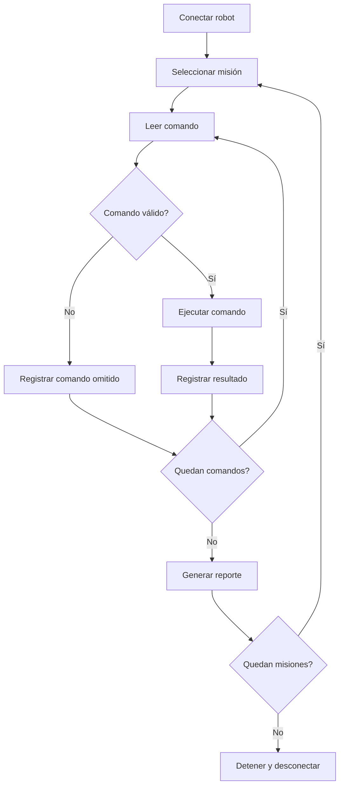

# Esquema Top-Down - Controlador de misiones

## Integrante

Santino López

## Descripción

El programa divide la ejecución de misiones en funciones independientes para validar comandos, comunicarse con el robot, procesar una secuencia y generar un reporte final.

## Descomposición del programa

```text
main()
|
|-- Conectar el robot
|
|-- Por cada misión
|   |-- Crear historial
|   |-- ejecutar_mision(robot, mision, historial)
|   |   |-- comando_es_valido(comando)
|   |   |-- ejecutar_comando(robot, comando) si es válido
|   |   `-- Registrar el resultado en historial
|   |
|   `-- generar_reporte(historial)
|       |-- Contar ejecutados y omitidos
|       |-- Calcular distancia y duración estimada
|       `-- Imprimir el reporte
|
`-- Detener y desconectar el robot
```

## Diagrama del funcionamiento



## Responsabilidades de las funciones

| Función | Entrada | Salida o efecto | Responsabilidad |
|---|---|---|---|
| `comando_es_valido()` | Tupla del comando | Booleano | Comprobar formato, tipos y límites |
| `ejecutar_comando()` | Robot y comando | Resultado de ejecución | Enviar una orden válida y manejar errores de seguridad |
| `ejecutar_mision()` | Robot, lista de comandos e historial | Historial actualizado | Procesar los comandos y registrar los resultados |
| `generar_reporte()` | Historial | Salida por consola | Calcular y mostrar estadísticas |
| `main()` | Misiones y conexión | Coordinación general | Conectar, ejecutar misiones y desconectar |

## Estructuras utilizadas

### Listas y tuplas

Las misiones contienen tuplas de comandos. Esta representación permite agregar otra misión sin modificar las funciones principales.

### Lista de diccionarios

Cada resultado queda registrado en un diccionario del historial, incluyendo el comando, si fue ejecutado y los valores utilizados para calcular el reporte.

### Decisiones e iteraciones

Se utilizan `if/elif`, `for` y `continue` para validar las órdenes, omitir las incorrectas y continuar con el resto de la misión.

## Ventaja del diseño

Las funciones se reutilizan para ejecutar diferentes secuencias de comandos. Para la misión propia solo fue necesario definir otra lista.
